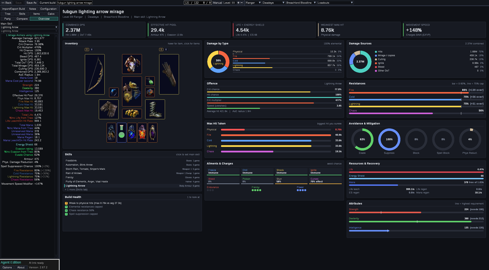
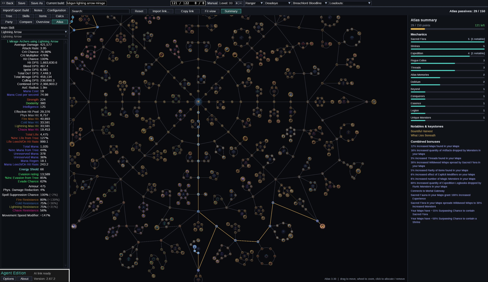

# PoB Agent Edition: an AI build assistant for Path of Building (Path of Exile 1)

**Let Claude, Codex or any MCP-capable AI read, analyse and improve your Path of Exile build inside Path of Building, live.**

PoB Agent Edition is a Path of Building Community fork with a built-in AI connection, plus an MCP server that gives AI assistants more than 100 Path of Building tools. Ask "why do I keep dying?" or "what is the best upgrade for 50 chaos?" and the AI answers with PoB's own calculations, edits the build in the open window and finds instant-buyout trade items that fit your build.

[](https://github.com/urbanvcode/pob-agent-edition/releases)


[](LICENSE)



## Contents

- [What it does](#what-it-does)
- [Install (Windows, about 5 minutes)](#install-windows-about-5-minutes)
- [First questions to ask your AI](#first-questions-to-ask-your-ai)
- [Supported AI apps](#supported-ai-apps)
- [Trade searches and account safety](#trade-searches-and-account-safety)
- [Updating](#updating)
- [FAQ](#faq)
- [Credits and license](#credits-and-license)

## What it does

| Feature | What you get |
|---|---|
| **Live AI control** | The AI reads and edits the build open in the PoB window (`127.0.0.1` only, nothing leaves your PC). You see every change immediately. |
| **Build diagnosis** | Resistances, max hit taken, EHP, suppression/block/evade, ailments, mana and reservation, DPS. Every number comes from PoB's own calculation, so there is no guessing. |
| **Cheap upgrade finder** | `plan_upgrades` searches pathofexile.com trade (instant buyout only), simulates each item in your build and ranks the results by gain per chaos. The results also appear in the **AI Advisor** card. |
| **Overview dashboard** | Dark theme, in-game style inventory with item icons, damage by type, skills, gear and ailments on one page. |
| **Atlas tree planner** | Plan the atlas passive tree with GGG's official 3.30 data: import or share links, see a summary per league mechanic, and let the AI plan it with you. |
| **Safe by default** | The AI never overwrites your build (it saves variants as new files), never buys anything and never touches the game client. |
| **Explains PoE1** | Made for players coming from Path of Exile 2: the AI explains PoE1 systems such as gem links, flasks, pantheon and the atlas, and compares them with PoE2. |



## Install (Windows, about 5 minutes)

**You need:** Windows 10 or 11, [Node.js 20 or newer](https://nodejs.org/) (the LTS version is fine), and an AI app that supports MCP (see [Supported AI apps](#supported-ai-apps)).

1. **Download** the latest `PoB-Agent-Edition-<version>-win64.zip` from [Releases](https://github.com/urbanvcode/pob-agent-edition/releases).
2. **Extract** it to any folder you like, for example `C:\Games\PoB Agent Edition`. Folders without spaces or special permissions work best. Avoid `Program Files`.
3. **Double-click `Install.cmd`** in that folder. It:
   - checks for Node.js and offers to install it with `winget` if it is missing,
   - adds **PoB Agent Edition** to the Start menu and the desktop,
   - connects the AI apps it finds (Claude Desktop, Claude Code, Codex) to the `pob` MCP server,
   - writes `mcp-config.json` for any other MCP app.
4. **Restart your AI app**, open **PoB Agent Edition** and load a build.
5. Optional, for trade searches: open **Options > Trade session ID** in PoB Agent Edition and paste your POESESSID ([how to find it](docs/TRADE.md#finding-your-poesessid)).

Your normal Path of Building keeps working as before. Agent Edition is a separate program and reads the same `Documents\Path of Building\Builds` folder.

### Other ways to install

Prefer not to run the installer? Both ways below work without it. All the installer does is create shortcuts and add one entry to your AI app's config.

<details>
<summary><b>Manual install (no scripts)</b></summary>

1. Install [Node.js 20+](https://nodejs.org/) (LTS).
2. Download and extract the release zip, for example to `C:\Games\PoB Agent Edition`.
3. Start PoB from `PathOfBuilding\runtime\Path{space}of{space}Building.exe`. You can right-click it and choose **Send to > Desktop (create shortcut)**.
4. Add the `pob` MCP server to your AI app. Replace `C:/Games/PoB Agent Edition` with your folder and use forward slashes.

   **Claude Desktop**: open **Settings > Developer > Edit Config** (`%APPDATA%\Claude\claude_desktop_config.json`) and add this inside `"mcpServers"`:

   ```json
   "pob": {
     "command": "node",
     "args": ["C:/Games/PoB Agent Edition/pob-mcp/build/index.js"],
     "env": {
       "POB_LUA_ENABLED": "true",
       "POB_CMD": "C:/Games/PoB Agent Edition/luajit/luajit.exe",
       "POB_PATH": "C:/Games/PoB Agent Edition/PathOfBuilding/src",
       "POB_TIMEOUT_MS": "60000",
       "POE_TRADE_ENABLED": "true",
       "POE_TRADE_ONLINE_STATUS": "securable"
     }
   }
   ```

   **Claude Code**: run this in a terminal:

   ```bash
   claude mcp add pob --scope user -e POB_LUA_ENABLED=true -e "POB_CMD=C:/Games/PoB Agent Edition/luajit/luajit.exe" -e "POB_PATH=C:/Games/PoB Agent Edition/PathOfBuilding/src" -e POB_TIMEOUT_MS=60000 -e POE_TRADE_ENABLED=true -e POE_TRADE_ONLINE_STATUS=securable -- node "C:/Games/PoB Agent Edition/pob-mcp/build/index.js"
   ```

   **Codex**: add this to `%USERPROFILE%\.codex\config.toml`:

   ```toml
   [mcp_servers.pob]
   command = "node"
   args = ["C:/Games/PoB Agent Edition/pob-mcp/build/index.js"]

   [mcp_servers.pob.env]
   POB_LUA_ENABLED = "true"
   POB_CMD = "C:/Games/PoB Agent Edition/luajit/luajit.exe"
   POB_PATH = "C:/Games/PoB Agent Edition/PathOfBuilding/src"
   POB_TIMEOUT_MS = "60000"
   POE_TRADE_ENABLED = "true"
   POE_TRADE_ONLINE_STATUS = "securable"
   ```

   **Other apps**: use the same command, args and env in their MCP settings.
5. Builds are read from `Documents\Path of Building\Builds`. To use another folder, add `"POB_DIRECTORY": "D:/My/Builds"` to `env`.
6. Restart the AI app.
</details>

<details>
<summary><b>From source with git (developers)</b></summary>

```powershell
git clone --recurse-submodules https://github.com/urbanvcode/pob-agent-edition.git
cd pob-agent-edition
cd pob-mcp; npm ci; npm run build; cd ..
.\Install.cmd    # optional: or follow the manual steps above
```

To update later, run `git pull`, then `git submodule update --init` and `npm ci && npm run build` in `pob-mcp`. See [docs/DEVELOPMENT.md](docs/DEVELOPMENT.md).
</details>

<details>
<summary>Uninstall</summary>

Run `Install.cmd -Uninstall`. It removes the shortcuts and the `pob` entry from the AI apps. Then delete the folder. Your builds are not touched.
</details>

## First questions to ask your AI

- "Check my build in PoB: what's wrong with it, most important first?"
- "Are my resistances capped? What is my weakest max hit?"
- "Find the best upgrades for 50 chaos per item in the current league."
- "Explain what suppression does, compared to PoE2."
- "Plan my atlas tree for Essence farming and explain each mechanic."
- "Try swapping this support gem and show me before/after DPS. Save it as a new build."

## Supported AI apps

Any app that can run a local **MCP (Model Context Protocol)** server over stdio works.

| App | Setup |
|---|---|
| Claude Desktop | Automatic (`Install.cmd`) |
| Claude Code (CLI, desktop, IDE) | Automatic, when the `claude` command is installed |
| OpenAI Codex CLI | Automatic, when `~/.codex` exists |
| Others (Cursor, Antigravity, Windsurf, VS Code, ...) | Copy the `pob` entry from `mcp-config.json` into the app's MCP settings |

AI assistants get their working rules (diagnosis order, trade safety, how to save) from the server automatically. A human-readable copy is in [AGENTS.md](AGENTS.md).

## Trade searches and account safety

- **Instant buyout listings only.** The AI shows you items and a trade link, and **you** click buyout. There is no whispering and no auto-buying.
- **Nothing touches the game client.** No overlays, no input automation, no memory reading.
- **Polite with GGG's servers.** At most 1 request every 2 seconds, every published pathofexile.com rate limit is respected before it is reached, and there are at most 16 trade requests per question. If the site asks for a pause, the AI tells you instead of retrying.
- **Your POESESSID stays on your PC.** It is stored in `Documents\Path of Building\AgentEdition.json` and is never printed or sent anywhere except pathofexile.com.

More details: [docs/TRADE.md](docs/TRADE.md) and [SECURITY.md](SECURITY.md).

## Updating

| What | How |
|---|---|
| PoB Agent Edition | Download the new release, extract it over the old folder (or into a new one) and run `Install.cmd` again. Git installs use `git pull`. The [changelog](CHANGELOG.md) lists what changed. A built-in update reminder and one-click updater are planned ([roadmap](ROADMAP.md), Stage 15). |
| Game data (items, uniques, passive tree) | Comes with each release. Releases follow official Path of Building Community updates. |
| Atlas tree | Comes from GGG's official export; developers run `tools/update-atlas.ps1`. |

## FAQ

**Is this the official Path of Building?**
No. It is a fork of [Path of Building Community](https://github.com/PathOfBuildingCommunity/PathOfBuilding) with extra AI features. All calculations are PoB's own.

**Does it work with Path of Exile 2?**
Not yet. This edition is for Path of Exile 1. A PoE2 edition is on the [roadmap](ROADMAP.md).

**Can it get my account banned?**
It never interacts with the game client and only uses the public trade website within its rate limits, the same way a person browsing the trade site does. You always buy manually.

**Does the AI see my builds or my POESESSID?**
The AI app sees the build data it asks PoB for, as with any MCP tool. The POESESSID is never shown to the AI or printed.

**Do I need an API key?**
No. You use your existing AI app (Claude, Codex, ...). PoB Agent Edition itself is free.

**Mac or Linux?**
Not supported yet, because Path of Building's runtime is Windows-only. It may work under Wine but is untested.

## Credits and license

- [Path of Building Community](https://github.com/PathOfBuildingCommunity/PathOfBuilding) by Openarl and the PoB Community team (MIT license, see `PathOfBuilding/LICENSE.md`).
- [pob-mcp](https://github.com/ianderse/pob-mcp) by ianderse (GPL-3.0).
- Atlas tree data: [grindinggear/atlastree-export](https://github.com/grindinggear/atlastree-export).
- [LuaJIT](https://luajit.org/) (MIT).

PoB Agent Edition's own code is licensed under the [GPL-3.0](LICENSE).

*This project is not affiliated with or endorsed by Grinding Gear Games. Path of Exile is a trademark of Grinding Gear Games.*

<sub>Keywords: Path of Building AI, PoB AI assistant, Path of Exile build optimizer, PoE build checker, Claude Path of Building, Codex Path of Building, Path of Building MCP server, PoE trade upgrade finder, PoE atlas tree planner, PoE1 build helper.</sub>
